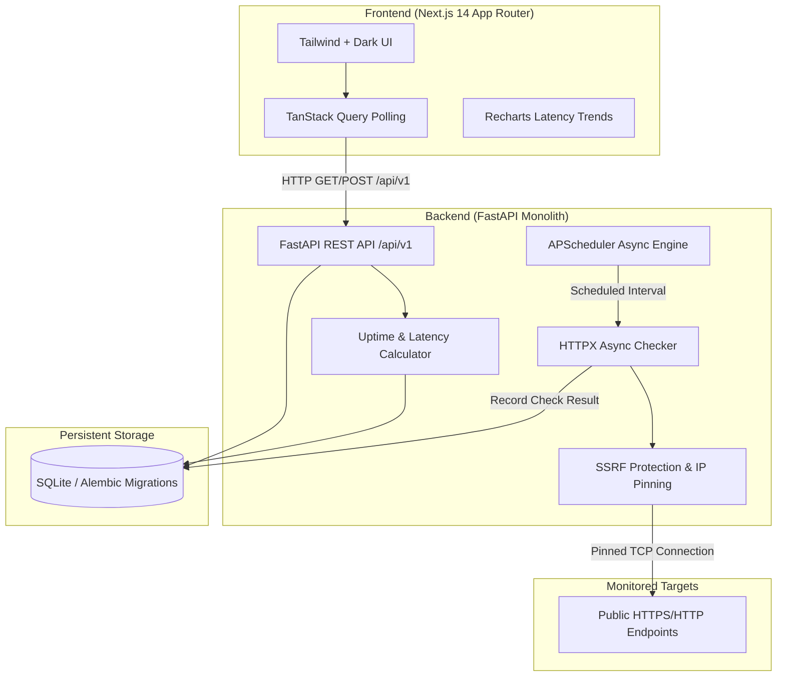

# API Sentinel — API Uptime & Performance Monitoring

API Sentinel is a modern, lightweight, developer-first API observability platform that continuously monitors HTTP/HTTPS endpoints, tracks availability and response times with monotonic clock precision, prevents SSRF/DNS-rebinding attacks, and visualizes system health through an intuitive dark-themed dashboard.

---

## Architecture Overview



---

## Key Features

- **Automated Asynchronous Monitoring**: Scheduled health checks run via `APScheduler` without blocking event loops.
- **Monotonic Latency Measurement**: Measures response time using `time.perf_counter()` in milliseconds.
- **Robust SSRF & DNS Rebinding Shield**:
  - Restricts outbound traffic to ports `80` and `443`.
  - Disallows private, loopback, link-local, multicast, CGNAT, and cloud metadata addresses (AWS/GCP/Azure).
  - Pins resolved, validated destination IPs to prevent DNS rebinding while preserving TLS SNI.
  - Rejects HTTP redirects to prevent server-side bounce attacks.
- **Check-Based Uptime Analytics**:
  - Transparent check-based availability formula: `(Successful Checks / Total Completed Checks) × 100`.
  - Excludes paused periods and handles cold starts gracefully.
- **Real-Time Developer Dashboard**:
  - Auto-refreshing metrics (10s polling with TanStack Query).
  - 4 key overview cards: Total, Healthy, Down monitors, and 24h Check-based Uptime.
  - Interactive latency charts with selectable time windows (`1h`, `24h`, `7d`).
  - Recent incident log capturing error categories and HTTP status codes.
- **Monitor Management**: Create, edit, pause, resume, delete, and trigger on-demand checks.
- **Crash Recovery**: Survives process restart without losing metrics; automatically restores and reschedules all active monitors.

---

## Tech Stack

### Frontend
- **Framework**: Next.js 14 (App Router)
- **Language**: TypeScript
- **Styling**: Tailwind CSS
- **Charts**: Recharts
- **Icons**: Lucide React
- **Data Fetching**: TanStack Query (React Query v5)
- **Form Validation**: React Hook Form + Zod

### Backend
- **Framework**: FastAPI
- **Language**: Python 3.12+
- **Database ORM**: SQLAlchemy 2.0
- **Migrations**: Alembic
- **Validation**: Pydantic v2
- **HTTP Client**: HTTPX (AsyncClient with custom network transport)
- **Job Scheduler**: APScheduler (AsyncIOScheduler)
- **Database**: SQLite (WAL enabled)

### Infrastructure
- **Containerization**: Docker & Docker Compose
- **CI/CD**: GitHub Actions

---

## Quick Start with Docker Compose

Ensure Docker and Docker Compose are installed:

```bash
cd api-sentinel
docker compose up --build
```

Access the applications:
- **Frontend Dashboard**: [http://localhost:3000](http://localhost:3000)
- **Backend API**: [http://localhost:8000](http://localhost:8000)
- **Interactive Swagger Docs**: [http://localhost:8000/docs](http://localhost:8000/docs)
- **System Health**: [http://localhost:8000/health](http://localhost:8000/health)

---

## Local Development Setup

### 1. Backend Setup

```bash
cd api-sentinel/backend

# Create virtual environment
python -m venv .venv
# On Linux/macOS: source .venv/bin/activate
# On Windows:
.venv\Scripts\activate

# Install dependencies
pip install -r requirements.txt

# Run migrations
alembic upgrade head

# Start development server
uvicorn app.main:app --reload --port 8000
```

### 2. Frontend Setup

```bash
cd api-sentinel/frontend

# Install dependencies
npm install

# Start development server
npm run dev
```

Visit [http://localhost:3000](http://localhost:3000).

---

## Backend API Specification

All REST endpoints reside under `/api/v1`:

| Method | Endpoint | Description |
|---|---|---|
| `GET` | `/health` | Service and scheduler health status |
| `GET` | `/api/v1/monitors` | List all monitors with uptime & avg latency |
| `POST` | `/api/v1/monitors` | Create monitor with SSRF validation |
| `GET` | `/api/v1/monitors/{id}` | Get monitor details by ID |
| `PATCH` | `/api/v1/monitors/{id}` | Update monitor configuration |
| `DELETE` | `/api/v1/monitors/{id}` | Delete monitor and cascade check history |
| `POST` | `/api/v1/monitors/{id}/pause` | Pause automated checks |
| `POST` | `/api/v1/monitors/{id}/resume` | Resume scheduled checks |
| `POST` | `/api/v1/monitors/{id}/check` | Trigger immediate on-demand health check |
| `GET` | `/api/v1/monitors/{id}/history` | Historical check results (`1h`, `24h`, `7d`, `all`) |
| `GET` | `/api/v1/monitors/{id}/stats` | Statistical breakdown for monitor |
| `GET` | `/api/v1/dashboard/overview` | Aggregated statistics for dashboard cards |
| `GET` | `/api/v1/dashboard/latency` | Chronological latency points for charts |
| `GET` | `/api/v1/dashboard/incidents` | Feed of recent failed checks |

---

## Running Automated Tests

Run the backend test suite:

```bash
cd api-sentinel/backend
pytest -v
```

The test suite exercises:
- Creating monitors with valid input
- Rejecting invalid URL formats and unsupported schemes
- Blocking private, loopback, and cloud metadata destinations
- Detecting and blocking DNS rebinding attempts
- HTTP connection timeouts and status code mismatches
- Check-based uptime calculation & empty history handling
- Pausing, resuming, and cascading deletions
- Overlapping check prevention

---

## Security Model & Limitations

1. **SSRF Defense Strategy**:
   - The application does not function as an open proxy.
   - Hostnames are resolved to IP addresses via `socket.getaddrinfo`. If *any* resolved address falls into reserved or private ranges, the check fails closed immediately.
   - Connections are pinned to the verified IP (`SafeSSRFTransport`) while maintaining TLS SNI verification for HTTPS certificates.
2. **Single-User MVP**:
   - Intended for single-tenant or internal developer use. Authentication and role-based access control (RBAC) are omitted for this MVP phase.
3. **Public Endpoints Only**:
   - Monitoring localhost services on the host machine is disallowed by design to uphold SSRF guarantees.

---

## License

This project is licensed under the [MIT License](LICENSE).
